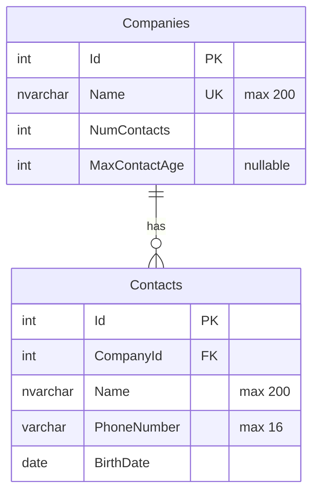

# Company Address Book

A simple app to import companies from a TXT file, add companies, and manage their contacts.

## Technologies

- ASP.NET Core Web API with .NET 10
- Entity Framework Core 10.0.12 and SQL Server
- Angular 22.2.4 with Reactive Forms
- xUnit for backend tests

## Project structure

```text
address-book-backend/
  src/AddressBook.Api/             API endpoints and request models
  src/AddressBook.Core/            Entities and business rules
  src/AddressBook.Infrastructure/  Database setup and migrations
  tests/AddressBook.Tests/         Tests and sample data
address-book-frontend/             Angular app
```

## Design choices

The backend uses a simple N-Tier (layered) structure. Api handles HTTP requests, Core contains the entities and business rules, and Infrastructure handles EF Core and SQL Server. These are separate projects, while the backend is deployed as one application.

- **Onion Architecture:** A fuller Onion structure with separate Domain and Application projects was not needed for this small task. The current layout already keeps business rules independent of HTTP and database code.
- **CQRS:** The app has simple read and write operations over two entities. Separate command and query models or handlers would add classes without a clear benefit for these requirements.
- **CORS:** Browser requests use the same origin in the current setup. Angular uses a proxy during development, and IIS hosts the frontend and API under the same website after deployment. If they are hosted on different origins later, a CORS policy can allow the specific frontend origin.
- **Phone numbers:** The task asks for a phone number for each contact, so it is stored in `Contacts`. A separate table was considered, but multiple numbers are not required. If needed later, `ContactPhoneNumbers` could link each number to a contact through `ContactId`, without repeating contact details. A unique constraint on `(ContactId, PhoneNumber)` could prevent duplicate numbers for the same contact. If companies need their own phone numbers, a similar table could use `CompanyId`.

## Business rules

- A company name must contain a digit from `0` to `9` directly before `§`, `®`, `™`, `©`, `ʬ` or `@`. For example, `ExpertPeople2®` is valid. Arabic names are supported; Arabic-Indic digits do not satisfy the digit rule.
- Company names are trimmed, limited to 200 characters, and case-sensitive. `A1®` and `a1®` are different names.
- A new company needs a name and a contact limit. The maximum contact age is optional. Both limits must be whole numbers of zero or more.
- A company can start without contacts. The sample company `D2ʬLL` has a contact limit of zero, so it is imported but cannot receive contacts.
- Contacts need a name, phone number and birthday. Phone numbers use `+` followed by 8 to 15 digits, with no spaces. The first digit must not be zero. Example: `+201012345678`.
- Future birthdays are rejected. Age is counted in full years using the UTC date. A February 29 birthday counts on February 28 in a non-leap year.
- A contact can be the same age as the company's maximum age. An empty maximum age means no age limit.
- Contacts cannot exceed the company's contact limit. The API checks the limit inside a SQL transaction and locks the company row while adding a contact.

## Database



Company names have a unique index. `CompanyId` is a foreign key, and a company with contacts cannot be deleted. Age is calculated from the birthday rather than stored.

## Run locally

Install the [.NET 10 SDK](https://dotnet.microsoft.com/download/dotnet/10.0), Node.js 24.15 or later in the 24.x release, and SQL Server 2019 or later. SQL Server Express is fine.

Open PowerShell at the project root:

```powershell
cd address-book-backend
dotnet restore AddressBook.slnx
dotnet tool restore
$env:ASPNETCORE_ENVIRONMENT = 'Development'
$env:ConnectionStrings__AddressBook = 'Server=lpc:.\SQLEXPRESS;Database=CompanyAddressBook;Integrated Security=True;Encrypt=True;TrustServerCertificate=True'
dotnet ef database update --project src/AddressBook.Infrastructure --startup-project src/AddressBook.Api
dotnet run --project src/AddressBook.Api
```

The connection string uses Windows authentication and a local `SQLEXPRESS` instance. Change `Server` if your instance has a different name. The Windows account running the migration needs permission to create the database. `lpc:` works only when SQL Server is on the same machine. The certificate trust setting above is for local development.

The API runs at `http://localhost:5080`. Open another terminal at the project root:

```powershell
cd address-book-frontend
npm ci
npm start
```

Open `http://localhost:4200`. Angular forwards `/api` requests to the API during development, so this setup does not need CORS.

## Import the sample

The sample file is here:

```text
address-book-backend/tests/AddressBook.Tests/TestData/XPE-Task-SampleData.txt
```

Open **Import companies** and select this file. Nothing is seeded automatically.

The file must use UTF-8, a header, and two tabs between the three columns: company name, contact limit and maximum age. If age is empty, keep the final two tabs. Blank lines are ignored. Files must be `.txt`, up to 1 MiB, with no more than 2,000 data rows.

Invalid rows are reported without stopping the other rows. Existing names and repeated names are skipped. Existing companies are not changed.

On an empty database, the sample imports 5 companies and rejects 7 rows. Importing it again adds no companies, skips 5 duplicates and rejects the same 7 rows.

## API endpoints

```text
GET  /api/companies
GET  /api/companies/{id}
POST /api/companies
POST /api/companies/import
GET  /api/companies/{id}/contacts
POST /api/companies/{id}/contacts
```

Company request:

```json
{ "name": "Example1®", "numContacts": 3, "maxContactAge": 30 }
```

Contact request:

```json
{ "name": "Alex", "phoneNumber": "+201012345678", "birthDate": "2000-10-30" }
```

For imports, send a multipart form with a file field named `file`. Validation errors return 400, missing companies return 404, and duplicate names or full contact limits return 409. Unexpected errors return a general 500 response without internal details.

## Tests

From the project root:

```powershell
cd address-book-backend
dotnet test AddressBook.slnx
```

SQL Server tests are skipped unless `SQLSERVER_TEST_CONNECTION` is set. To run all tests:

```powershell
$env:SQLSERVER_TEST_CONNECTION = 'Server=lpc:.\SQLEXPRESS;Database=master;Integrated Security=True;Encrypt=True;TrustServerCertificate=True'
dotnet test AddressBook.slnx
```

These tests create and delete a separate database named `AddressBook_Test_<GUID>`. The account needs permission to create and delete databases. The application database is not deleted.

Tests cover company names, imports, duplicate records, phone numbers, birthdays, age limits, contact limits, concurrent requests and SQL Server constraints.

## Deploy to IIS

Host Angular at the website root and the API as an IIS application named `backend` under the same website.

1. Enable IIS Management Console, Static Content, Default Document, HTTP Errors and Request Filtering. Install [URL Rewrite 2.1](https://www.iis.net/downloads/microsoft/url-rewrite) and the **.NET 10 Hosting Bundle** from the [.NET download page](https://dotnet.microsoft.com/download/dotnet/10.0). Install the Hosting Bundle after IIS, or repair it if IIS was installed later. Restart IIS after installation.

2. Build from the project root:

   ```powershell
   dotnet restore address-book-backend/AddressBook.slnx
   dotnet publish address-book-backend/src/AddressBook.Api -c Release -o artifacts/api
   npm --prefix address-book-frontend ci
   npm --prefix address-book-frontend run build
   ```

3. Apply migrations to the target SQL Server before starting the API. Run these commands from the project root using an account with database setup permissions:

   ```powershell
   cd address-book-backend
   dotnet tool restore
   $env:ASPNETCORE_ENVIRONMENT = 'Production'
   $env:ConnectionStrings__AddressBook = 'Server=.\SQLEXPRESS;Database=CompanyAddressBook;Integrated Security=True;Encrypt=True;TrustServerCertificate=False'
   dotnet ef database update --project src/AddressBook.Infrastructure --startup-project src/AddressBook.Api
   cd ..
   ```

   Replace the server name as needed. Production SQL connections need a trusted SQL Server certificate. The API does not apply migrations at startup.

4. Create `C:\inetpub\CompanyAddressBook\frontend`, `C:\inetpub\CompanyAddressBook\api` and `C:\inetpub\CompanyAddressBook\temp`. Copy the contents of `address-book-frontend\dist\address-book\browser` into the frontend folder. Copy the contents of `artifacts\api` into the API folder. Keep both `web.config` files.

5. In IIS Manager, create two application pools: `AddressBookWeb` and `AddressBookApi`. Set both to **No Managed Code**, **Integrated**, and **Enable 32-Bit Applications = False**. Keep **ApplicationPoolIdentity** as the identity.

6. Create a website using the frontend folder and the `AddressBookWeb` pool. Add an HTTPS binding with your hostname and certificate. Under the website, add an application with alias `backend`, using the API folder and the `AddressBookApi` pool.

7. Give `IIS AppPool\AddressBookWeb` Read & Execute access to the frontend folder. Give `IIS AppPool\AddressBookApi` Read & Execute access to the API folder and Modify access to the temp folder. The API may use temporary files while reading uploads.

8. For SQL Server on the same machine, run the following as a SQL administrator:

   ```sql
   USE [master];
   CREATE LOGIN [IIS APPPOOL\AddressBookApi] FROM WINDOWS;
   USE [CompanyAddressBook];
   CREATE USER [IIS APPPOOL\AddressBookApi] FOR LOGIN [IIS APPPOOL\AddressBookApi];
   ALTER ROLE [db_datareader] ADD MEMBER [IIS APPPOOL\AddressBookApi];
   ALTER ROLE [db_datawriter] ADD MEMBER [IIS APPPOOL\AddressBookApi];
   ```

   For SQL Server on another machine, use a domain service account for the API pool and give it the same database access. Keep database migration permissions separate from the running API.

9. In the deployed API's `web.config`, add this inside the existing `<aspNetCore>` element. If it is self-closing, change it to an opening and closing element first:

   ```xml
   <environmentVariables>
     <environmentVariable name="ASPNETCORE_ENVIRONMENT" value="Production" />
     <environmentVariable name="ConnectionStrings__AddressBook" value="Server=.\SQLEXPRESS;Database=CompanyAddressBook;Integrated Security=True;Encrypt=True;TrustServerCertificate=False" />
     <environmentVariable name="AllowedHosts" value="addressbook.example.test" />
     <environmentVariable name="ASPNETCORE_TEMP" value="C:\inetpub\CompanyAddressBook\temp" />
   </environmentVariables>
   ```

   Change the server and hostname to match your setup. No password is needed with Windows authentication.

10. Change the deployed frontend's `config.json` to:

    ```json
    { "apiBaseUrl": "/backend/api" }
    ```

    The included frontend `web.config` handles Angular page refreshes and keeps API requests out of the Angular fallback.

11. Start the website and both pools. Check `https://addressbook.example.test/backend/api/companies`, then open the website. Import the sample twice, add a contact, and refresh a contacts page to check the routing.

For an update, stop the API pool before replacing its files. Apply any new migrations with the database setup account, keep the deployed settings, and restart the pool. Build output and local settings are excluded from Git.

### Common problems

- **500.19:** check that URL Rewrite and the Hosting Bundle are installed, and that `web.config` is valid.
- **500.30 or 500.31:** check the .NET 10 runtime, connection string and Windows Event Viewer.
- **SQL login failed:** check the API pool identity and its database permissions.
- **API returns HTML:** check the `backend` IIS application and `/backend/api` in the deployed `config.json`.
- **Page refresh returns 404:** check the frontend `web.config` and URL Rewrite.

## Current status

- Backend and Angular builds passed. All 70 tests passed with SQL Server 2025 Express.
- The published app was tested locally on IIS Express: pages, API requests, imports and Angular page refreshes worked.
- Full IIS hosting with production HTTPS and application pool permissions has not been tested. Allow about 30–60 minutes to check it on a configured machine.
- No application features are left unfinished. The source code is available in the public GitHub repository.
